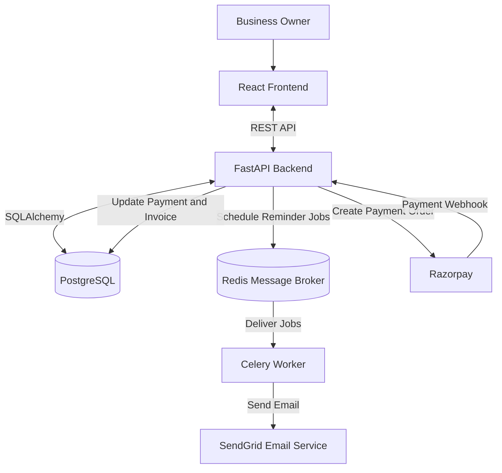
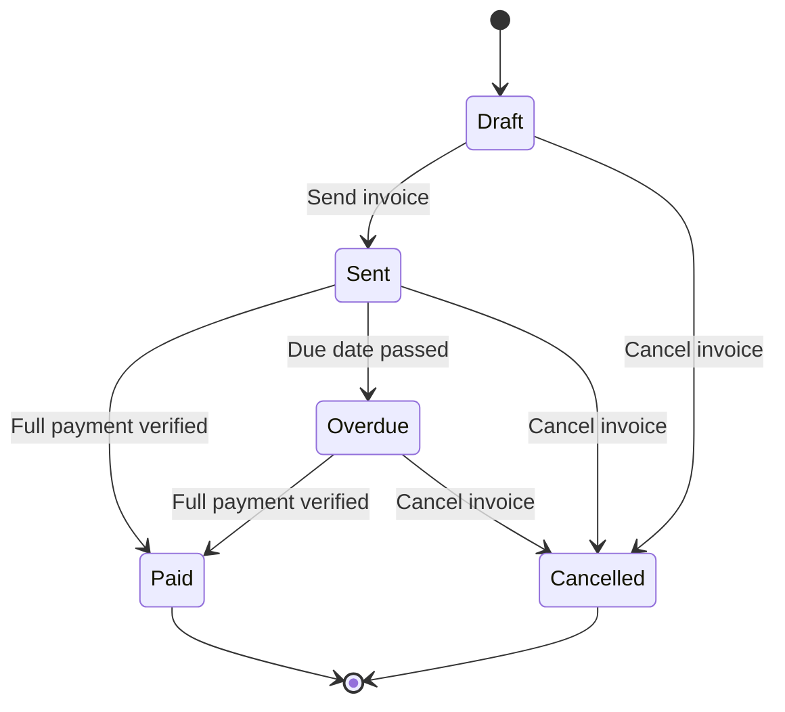
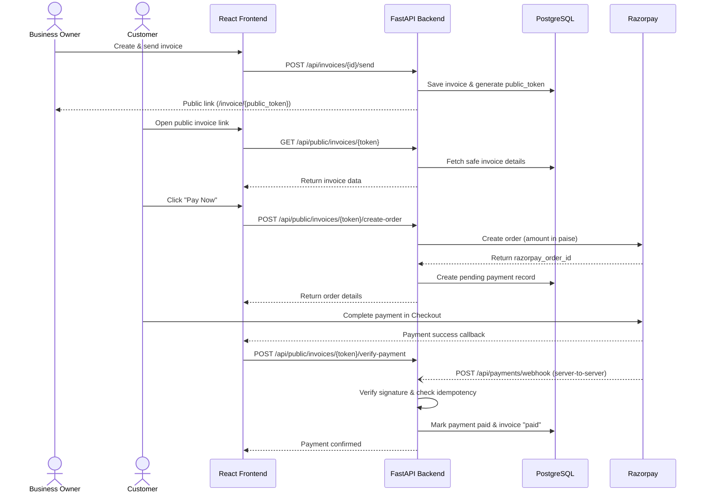

PayNudge – System Design Document

Version: 2.0
Project: PayNudge
Backend: Python + FastAPI (proposed, pending approval)
Database: PostgreSQL
Status: Design under review

1. Project Overview

PayNudge is a web-based invoice and payment reminder platform designed for small businesses, freelancers, tutors, shops, and agencies in India.

The platform allows business owners to manage customers, create and send invoices, receive online payments through Razorpay, and automatically send email reminders for pending invoices.

The main objective is to reduce late payments and simplify invoice management.

2. Core MVP Features

1. User registration and authentication.
2. Business profile management.
3. Customer management.
4. Invoice creation and management with multiple line items.
5. Invoice sharing through secure public links.
6. Online payments through Razorpay with payment tracking.
7. Automatic email reminders before and after invoice due dates.
8. Invoice status tracking, including pending, paid, overdue, and cancelled.

3. Technology Stack

| Component | Technology |
| :--- | :--- |
| Frontend | React |
| Backend | Python + FastAPI |
| Database | PostgreSQL |
| ORM | SQLAlchemy |
| Data Validation | Pydantic |
| Database Migrations | Alembic |
| Background Jobs | Celery |
| Message Broker | Redis |
| Payment Gateway | Razorpay (Test Mode) |
| Email Service | SendGrid (proposed) |
| Testing | Pytest |
| Containerization | Docker |
| CI/CD | GitHub Actions |

Note: FastAPI and SendGrid are proposed changes requiring Tech Lead approval. The original project specification specifies Node.js + Express and does not specify an email provider.

4. System Architecture

The system follows a client-server architecture.

- React provides the user interface for business owners.
- FastAPI handles REST API requests, authentication, invoice management, and payment operations.
- PostgreSQL stores application data.
- Redis acts as the message broker for background jobs.
- Celery workers execute scheduled reminder tasks.
- The email service sends invoice and payment reminder notifications.
- Razorpay handles online payments and sends payment events through webhooks.

4.1 Architecture Diagram

5. Database Design

The database uses a relational model with seven tables:

1. Users
2. Businesses
3. Customers
4. Invoices
5. Invoice Items
6. Payments
7. Reminders

5.1 Tenant Model

For the MVP, one user can own only one business.

The "businesses.user_id" column will have a UNIQUE constraint to enforce this relationship.

This simplifies authorization and ensures that every authenticated user accesses only their own business data.

Multiple businesses per user can be considered in a future version.

5.2 Entity Relationship Diagram


### 5.2 Entity Relationship Diagram

```mermaid
erDiagram
    USERS ||--|| BUSINESSES : owns
    BUSINESSES ||--o{ CUSTOMERS : manages
    BUSINESSES ||--o{ INVOICES : creates
    CUSTOMERS ||--o{ INVOICES : receives
    INVOICES ||--|{ INVOICE_ITEMS : contains
    INVOICES ||--o{ PAYMENTS : has
    INVOICES ||--o{ REMINDERS : schedules

    USERS {
        int id PK
        varchar name
        varchar email UK
        varchar password_hash
        timestamp created_at
        timestamp updated_at
    }

    BUSINESSES {
        int id PK
        int user_id FK_UK
        varchar name
        varchar phone
        text address
        timestamp created_at
        timestamp updated_at
    }

    CUSTOMERS {
        int id PK
        int business_id FK
        varchar name
        varchar email
        varchar phone
        timestamp created_at
        timestamp updated_at
    }

    INVOICES {
        int id PK
        int business_id FK
        int customer_id FK
        varchar invoice_number
        varchar public_token UK
        numeric total_amount
        char currency
        date issue_date
        date due_date
        varchar status
        timestamp created_at
        timestamp updated_at
    }

    INVOICE_ITEMS {
        int id PK
        int invoice_id FK
        varchar description
        int quantity
        numeric unit_price
        numeric amount
    }

    PAYMENTS {
        int id PK
        int invoice_id FK
        varchar razorpay_order_id UK
        varchar razorpay_payment_id UK
        numeric amount
        char currency
        varchar status
        timestamp paid_at
        timestamp created_at
    }

    REMINDERS {
        int id PK
        int invoice_id FK
        timestamp scheduled_at
        timestamp sent_at
        varchar status
        varchar channel
        timestamp created_at
        timestamp updated_at
    }
```

5.3 Table Specifications

Users

| Column | Data Type | Constraint |
| :--- | :--- | :--- |
| `id` | `BIGINT` | Primary Key |
| `name` | `VARCHAR(100)` | NOT NULL |
| `email` | `VARCHAR(255)` | UNIQUE, NOT NULL |
| `password_hash` | `TEXT` | NOT NULL |
| `created_at` | `TIMESTAMP` | NOT NULL |
| `updated_at` | `TIMESTAMP` | NOT NULL |

Businesses

| Column | Data Type | Constraint |
| :--- | :--- | :--- |
| `id` | `BIGINT` | Primary Key |
| `user_id` | `BIGINT` | FK, UNIQUE, NOT NULL |
| `name` | `VARCHAR(150)` | NOT NULL |
| `phone` | `VARCHAR(20)` | NOT NULL |
| `address` | `TEXT` | NULL |
| `created_at` | `TIMESTAMP` | NOT NULL |
| `updated_at` | `TIMESTAMP` | NOT NULL |

Customers

| Column | Data Type | Constraint |
| :--- | :--- | :--- |
| `id` | `BIGINT` | Primary Key |
| `business_id` | `BIGINT` | FK, NOT NULL |
| `name` | `VARCHAR(150)` | NOT NULL |
| `email` | `VARCHAR(255)` | NULL |
| `phone` | `VARCHAR(20)` | NULL |
| `created_at` | `TIMESTAMP` | NOT NULL |
| `updated_at` | `TIMESTAMP` | NOT NULL |

Invoices

| Column | Data Type | Constraint |
| :--- | :--- | :--- |
| `id` | `BIGINT` | Primary Key |
| `business_id` | `BIGINT` | FK, NOT NULL |
| `customer_id` | `BIGINT` | FK, NOT NULL |
| `invoice_number` | `VARCHAR(50)` | NOT NULL |
| `public_token` | `VARCHAR(128)` | UNIQUE, NOT NULL |
| `total_amount` | `NUMERIC(12,2)` | NOT NULL |
| `currency` | `CHAR(3)` | Default `INR` |
| `issue_date` | `DATE` | NOT NULL |
| `due_date` | `DATE` | NOT NULL |
| `status` | `VARCHAR(20)` | NOT NULL |
| `created_at` | `TIMESTAMP` | NOT NULL |
| `updated_at` | `TIMESTAMP` | NOT NULL |

Unique constraint: "(business_id, invoice_number)".

The public token will be generated using a cryptographically secure random generator. It will provide customers with access to their invoice without requiring an account.

Invoice Items

| Column | Data Type | Constraint |
| :--- | :--- | :--- |
| `id` | `BIGINT` | Primary Key |
| `invoice_id` | `BIGINT` | FK, NOT NULL |
| `description` | `VARCHAR(255)` | NOT NULL |
| `quantity` | `INTEGER` | NOT NULL |
| `unit_price` | `NUMERIC(12,2)` | NOT NULL |
| `amount` | `NUMERIC(12,2)` | NOT NULL |

Payments

| Column | Data Type | Constraint |
| :--- | :--- | :--- |
| `id` | `BIGINT` | Primary Key |
| `invoice_id` | `BIGINT` | FK, NOT NULL |
| `razorpay_order_id` | `VARCHAR(100)` | UNIQUE |
| `razorpay_payment_id` | `VARCHAR(100)` | UNIQUE |
| `amount` | `NUMERIC(12,2)` | NOT NULL |
| `currency` | `CHAR(3)` | Default `INR` |
| `status` | `VARCHAR(20)` | NOT NULL |
| `paid_at` | `TIMESTAMP` | NULL |
| `created_at` | `TIMESTAMP` | NOT NULL |

Reminders

| Column | Data Type | Constraint |
| :--- | :--- | :--- |
| `id` | `BIGINT` | Primary Key |
| `invoice_id` | `BIGINT` | FK, NOT NULL |
| `scheduled_at` | `TIMESTAMP` | NOT NULL |
| `sent_at` | `TIMESTAMP` | NULL |
| `status` | `VARCHAR(20)` | NOT NULL |
| `channel` | `VARCHAR(20)` | Default `email` |
| `created_at` | `TIMESTAMP` | NOT NULL |
| `updated_at` | `TIMESTAMP` | NOT NULL |

5.4 Money Handling

All monetary values will be stored in PostgreSQL using "NUMERIC(12,2)" to avoid floating-point precision errors.

The default currency is INR.

Razorpay expects payment amounts in paise as integers.

Conversion:

- INR to paise: Multiply the amount by 100.
- Paise to INR: Divide the amount by 100.

Example:

- Invoice amount: ₹1,500.50
- Razorpay amount: 150050 paise.

Conversions will use decimal arithmetic and integer paise, not floating-point calculations.

5.5 Database Constraints and Indexes

- "users.email" must be unique.
- "businesses.user_id" must be unique for the MVP.
- "(business_id, invoice_number)" must be unique.
- "invoices.public_token" must be unique.
- "payments.razorpay_payment_id" must be unique.
- "payments.razorpay_order_id" must be unique.
- Add indexes on "invoices.due_date" and "invoices.status".
- Add indexes on foreign-key columns used for lookups.
- Add "updated_at" columns to mutable business records.

Customer deletion will be blocked if the customer has any associated invoices. Customers with invoice history will be retained.

6. Invoice Lifecycle and Payment Rules

6.1 Invoice Statuses

The invoice lifecycle will use the following statuses:

- "draft": Invoice created but not sent.
- "sent": Invoice shared with the customer.
- "overdue": Sent invoice whose due date has passed and remains unpaid.
- "paid": Full invoice amount successfully paid.
- "cancelled": Invoice cancelled by the business owner.

6.2 Status Transition Diagram


Invalid transitions will be rejected by the backend.

6.3 Overdue Processing

A daily Celery scheduled task will check invoices whose due dates have passed.

If an invoice is in "sent" status, has an outstanding balance, and its due date has passed, its status will change to "overdue".

6.4 Payment Rules

Partial payments will not be supported in the MVP.

Customers must pay the complete invoice amount.

An invoice will be marked "paid" only after successful payment verification.

Failed payment attempts will not change the invoice to "paid".

6.5 Reminder Cancellation

When an invoice becomes "paid" or "cancelled", all its pending reminders will be marked "cancelled".

The Celery worker will also recheck the invoice status before sending any reminder, preventing reminders from being sent for paid or cancelled invoices.

7. Public Invoice and Customer Payment Flow

Customers do not need an account to view or pay an invoice.

Each sent invoice will have a secure, unguessable public link containing a randomly generated token.

Example:

"https://paynudge.example.com/invoice/{public_token}"

Customer Payment Flow

1. Business owner creates an invoice.
2. Business owner sends the invoice.
3. Backend generates a secure public invoice link.
4. Customer opens the link.
5. Frontend requests invoice details using the public token.
6. Backend returns safe invoice information.
7. Customer clicks Pay Now.
8. Backend creates a Razorpay order for the full invoice amount.
9. Customer completes payment through Razorpay Checkout.
10. Backend verifies the payment signature or processes the verified webhook.
11. Payment record is updated.
12. Invoice status changes to "paid".




Public invoice endpoints will expose only the information required for invoice viewing and payment. Business owner credentials and internal records will never be exposed.

8. API Design

All APIs use the "/api" prefix and JSON request/response formats.

8.1 Authentication APIs

| Method | Endpoint | Description |
| :--- | :--- | :--- |
| `POST` | `/api/auth/register` | Register a user |
| `POST` | `/api/auth/login` | Authenticate user |
| `GET` | `/api/auth/me` | Retrieve authenticated user details |

8.2 Customer APIs

All customer endpoints require authentication and automatically use the authenticated user's business.

| Method | Endpoint | Description |
| :--- | :--- | :--- |
| `POST` | `/api/customers` | Create customer |
| `GET` | `/api/customers` | List customers |
| `GET` | `/api/customers/{customer_id}` | Retrieve customer |
| `PUT` | `/api/customers/{customer_id}` | Update customer |
| `DELETE` | `/api/customers/{customer_id}` | Delete customer if no invoices exist |

8.3 Invoice APIs

| Method | Endpoint | Description |
| :--- | :--- | :--- |
| `POST` | `/api/invoices` | Create invoice |
| `GET` | `/api/invoices` | List invoices |
| `GET` | `/api/invoices/{invoice_id}` | Retrieve invoice |
| `PUT` | `/api/invoices/{invoice_id}` | Update eligible invoice |
| `POST` | `/api/invoices/{invoice_id}/send` | Send invoice to customer |
| `POST` | `/api/invoices/{invoice_id}/cancel` | Cancel invoice |
| `GET` | `/api/invoices/{invoice_id}/payments` | Retrieve invoice payments |

8.4 Public Invoice APIs

These endpoints do not require customer authentication. Access is controlled by the secure public token.

| Method | Endpoint | Description |
| :--- | :--- | :--- |
| `GET` | `/api/public/invoices/{token}` | Retrieve public invoice details |
| `POST` | `/api/public/invoices/{token}/create-order` | Create Razorpay order for invoice |
| `POST` | `/api/public/invoices/{token}/verify-payment` | Verify checkout payment |

8.5 Payment APIs

| Method | Endpoint | Description |
| :--- | :--- | :--- |
| `GET` | `/api/payments/{payment_id}` | Retrieve payment details |
| `POST` | `/api/payments/webhook` | Receive Razorpay payment events |

The webhook endpoint is server-to-server and does not use normal user authentication. It must verify Razorpay's webhook signature using the configured webhook secret.

Duplicate webhook events will be handled idempotently so that the same payment is never recorded twice.

8.6 Reminder APIs

| Method | Endpoint | Description |
| :--- | :--- | :--- |
| `GET` | `/api/reminders` | List reminders |
| `GET` | `/api/invoices/{invoice_id}/reminders` | List reminders for invoice |
| `POST` | `/api/reminders/{reminder_id}/retry` | Retry an eligible failed reminder |

8.7 Pagination and Filtering

List endpoints will support pagination and relevant filters.

Example:

"GET /api/invoices?status=overdue&page=1&limit=20"

Supported parameters:

- "page": Page number.
- "limit": Number of records per page.
- "status": Filter by invoice status.

The API will return records along with pagination metadata.

9. Background Reminder System

Celery and Redis will manage scheduled reminder tasks.

9.1 Reminder Schedule

The proposed MVP reminder schedule is:

| Timing | Action |
| :--- | :--- |
| 3 days before due date | Send payment reminder |
| On due date | Send payment reminder |
| 3 days after due date | Send overdue reminder |
| 7 days after due date | Send overdue reminder |

9.2 Reminder Configuration

The reminder schedule will initially be maintained in application configuration.

Celery will schedule reminder jobs when an invoice is sent.

The worker will check the invoice status before sending each reminder.

Only email notifications will be supported in the MVP. WhatsApp integration is reserved for future scope.

SendGrid is the proposed email provider, subject to approval.

Failed reminder jobs will support retry handling.

10. Security Considerations

- Passwords will be stored as secure password hashes.
- Protected APIs will require authenticated access.
- Users can access only their own business data.
- Public invoice links will use cryptographically secure random tokens.
- Razorpay payment signatures and webhook signatures will be verified.
- Duplicate payment events will be handled idempotently.
- Secrets and API keys will be stored in environment variables.
- Public invoice endpoints will use rate limiting.
- Payment amounts will always be validated against the original invoice amount.

11. Open Questions

The following decisions need confirmation from the Tech Lead before implementation:

1. Backend Technology: Can we use Python FastAPI instead of the originally specified Node.js and Express?

2. Email Provider: Is SendGrid approved for email delivery, or should we use another SMTP-based provider?

3. Reminder Schedule: Is the proposed schedule (3 days before, on the due date, 3 days after, and 7 days after) acceptable?

4. Partial Payments: Is full payment only acceptable for the MVP, with partial payments reserved for a future version?

5. Multiple Businesses: Is the one-business-per-user restriction acceptable for the MVP?

6. Public Invoice Links: Should public invoice links remain valid indefinitely, or should they expire after a specified period?

7. Invoice Editing: Should sent invoices be editable, or must they be cancelled and recreated when corrections are required?

8. Payment Refunds: Are refunds outside the scope of the first version?

12. Future Scope

- WhatsApp payment reminders.
- Multiple businesses per user.
- Partial invoice payments.
- Customizable reminder schedules.
- Payment refunds and reconciliation.
- Advanced invoice analytics.

13. Conclusion

PayNudge will provide small businesses with a centralized system for invoice creation, customer management, online payment collection, and automated payment reminders.

The proposed architecture separates API processing, database persistence, payment integration, and background reminder execution to support maintainability and future scalability.