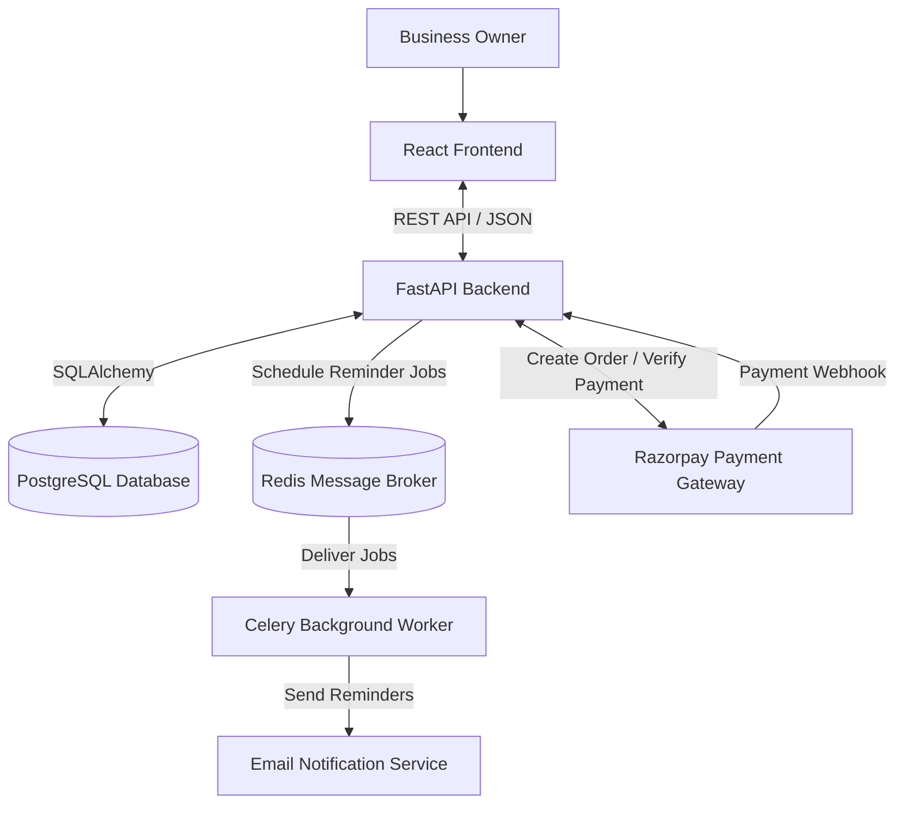
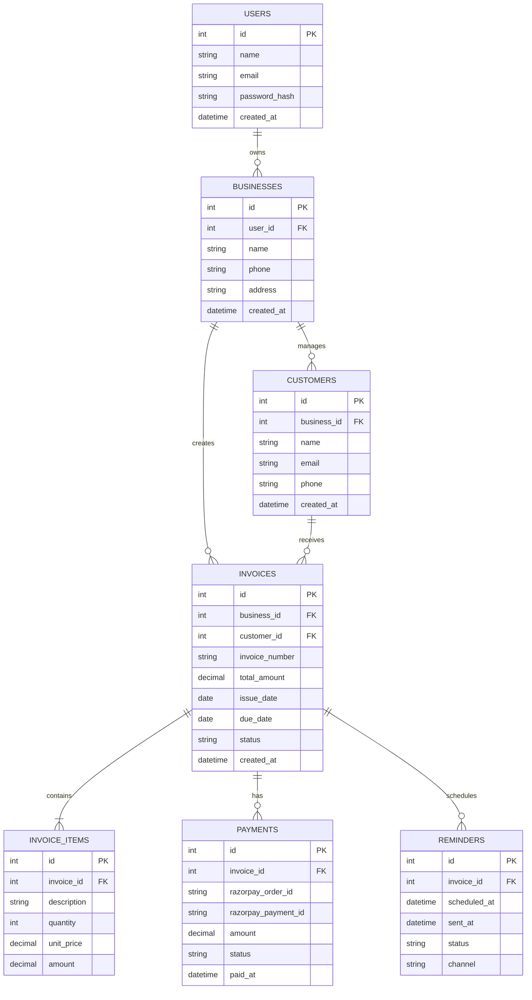

# PayNudge - system design document 

## project overview 
PayNudge is a simulated software engineering internship project designed as a multi-tenant invoicing and payment-reminder SaaS platform for small businesses in India (such as shops, tutors, freelancers, and agencies).

## Core Purpose & Problem
Small businesses often track invoices manually in notebooks or Excel and lose money because customers pay late and no one follows up. PayNudge solves this by allowing businesses to create invoices, send them to customers, accept online payments, and automatically trigger payment reminders before and after due dates.

## Tech Stack

| Layer | Technology |
| :--- | :--- |
| Frontend | React |
| Backend | Python + FastAPI |
| Database | PostgreSQL |
| ORM | SQLAlchemy |
| Validation | Pydantic |
| Database migrations | Alembic |
| Background jobs | Celery |
| Message broker | Redis |
| Payments | Razorpay |
| Testing | Pytest |
| Containerization | Docker |
| CI/CD | GitHub Actions |

## core MVP Features 
 1. Business registration and login .
 2. Customer management.
 3. Invoice creation with item detail.
 4. Invoice listing and status tracking.
 5. Automatic payment remainders.
 6. Online payments through Razorpay
 7. payment tracking and invoice status updates.
 8. customer notifications through email.

## System Architecture

## Database Design

### Entity-Relationship Diagram

### 1. Users
| Column | Purpose |
| :--- | :--- |
| `id` (PK) | Unique user ID |
| `name` | User's name |
| `email` | Login email |
| `password_hash` | Encrypted password hash |
| `created_at` | Registration time |

### 2. Businesses
| Column | Purpose |
| :--- | :--- |
| `id` (PK) | Business ID |
| `user_id` (FK) | Owner's user ID |
| `name` | Business name |
| `phone` | Business contact |
| `address` | Business address |
| `created_at` | Creation time |

### 3. Customers
| Column | Purpose |
| :--- | :--- |
| `id` (PK) | Customer ID |
| `business_id` (FK) | Associated business |
| `name` | Customer name |
| `email` | Customer email |
| `phone` | Customer phone |
| `created_at` | Creation time |

### 4. Invoices
| Column | Purpose |
| :--- | :--- |
| `id` (PK) | Invoice ID |
| `business_id` (FK) | Business that created it |
| `customer_id` (FK) | Customer receiving it |
| `invoice_number` | Unique invoice number |
| `total_amount` | Total invoice amount |
| `issue_date` | Invoice creation date |
| `due_date` | Payment deadline |
| `status` | `draft`, `pending`, `paid`, `overdue` |
| `created_at` | Creation time |

### 5. Invoice_items
| Column | Purpose |
| :--- | :--- |
| `id` (PK) | Item ID |
| `invoice_id` (FK) | Associated invoice |
| `description` | Product/service name |
| `quantity` | Number of units |
| `unit_price` | Price per unit |
| `amount` | Total item amount |

### 6. Payments
| Column | Purpose |
| :--- | :--- |
| `id` (PK) | Payment ID |
| `invoice_id` (FK) | Associated invoice |
| `razorpay_order_id` | Razorpay order reference |
| `razorpay_payment_id` | Razorpay payment reference |
| `amount` | Paid amount |
| `status` | `pending`, `successful`, `failed` |
| `paid_at` | Payment time |

### 7. Reminders
| Column | Purpose |
| :--- | :--- |
| `id` (PK) | Reminder ID |
| `invoice_id` (FK) | Associated invoice |
| `scheduled_at` | When reminder should be sent |
| `sent_at` | Actual sending time |
| `status` | `scheduled`, `sent`, `failed`, `cancelled` |
| `channel` | `email` or `whatsapp` |

##  API Design

The backend will use Python FastAPI to expose REST APIs. These APIs will handle user authentication, customer management, invoice creation, payment processing, and reminder management.

### Authentication APIs
| Method | Endpoint | Description |
| :--- | :--- | :--- |
| `POST` | `/api/auth/register` | Register a new user |
| `POST` | `/api/auth/login` | Authenticate user and generate access token |
| `GET` | `/api/auth/me` | Get current authenticated user's details |

### Customer APIs
| Method | Endpoint | Description |
| :--- | :--- | :--- |
| `POST` | `/api/customers` | Create a new customer |
| `GET` | `/api/customers` | Retrieve all customers of the business |
| `GET` | `/api/customers/{customer_id}` | Retrieve customer details |
| `PUT` | `/api/customers/{customer_id}` | Update customer information |
| `DELETE` | `/api/customers/{customer_id}` | Delete a customer if eligible |

###  Invoice APIs
| Method | Endpoint | Description |
| :--- | :--- | :--- |
| `POST` | `/api/invoices` | Create a new invoice |
| `GET` | `/api/invoices` | Retrieve all invoices |
| `GET` | `/api/invoices/{invoice_id}` | Retrieve invoice details |
| `PUT` | `/api/invoices/{invoice_id}` | Update invoice information |
| `GET` | `/api/invoices/{invoice_id}/payments` | Retrieve payments associated with an invoice |

### Payment APIs
| Method | Endpoint | Description |
| :--- | :--- | :--- |
| `POST` | `/api/payments/create-order` | Create a Razorpay payment order |
| `POST` | `/api/payments/verify` | Verify payment signature after checkout |
| `POST` | `/api/payments/webhook` | Receive payment events from Razorpay |
| `GET` | `/api/payments/{payment_id}` | Retrieve payment details |

### Reminder APIs
| Method | Endpoint | Description |
| :--- | :--- | :--- |
| `GET` | `/api/reminders` | Retrieve scheduled reminders |
| `GET` | `/api/invoices/{invoice_id}/reminders` | Retrieve reminders for a specific invoice |

### API Notes
* All protected endpoints require user authentication.
* The backend validates incoming requests using Pydantic schemas.
* FastAPI communicates with PostgreSQL through SQLAlchemy.
* Razorpay handles online payment processing.
* Razorpay webhooks notify the backend about payment events.
* Celery workers process scheduled reminder jobs using Redis as the message broker.
* API responses use appropriate HTTP status codes.
* Business data must be isolated so users cannot access another business's records.